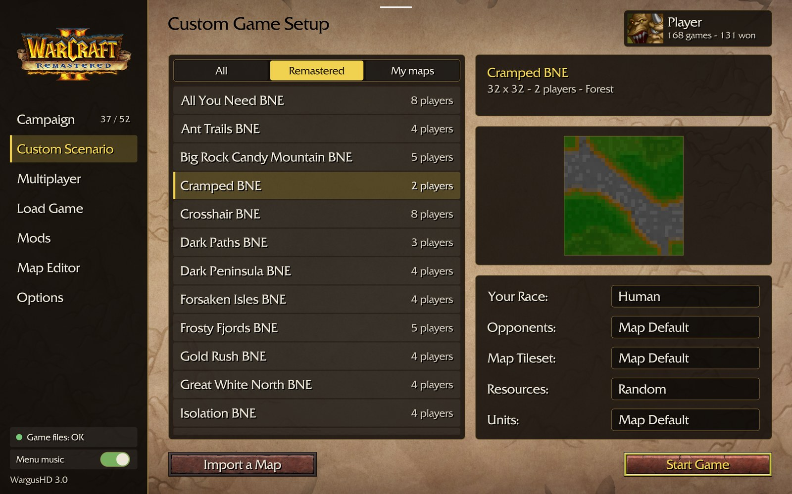
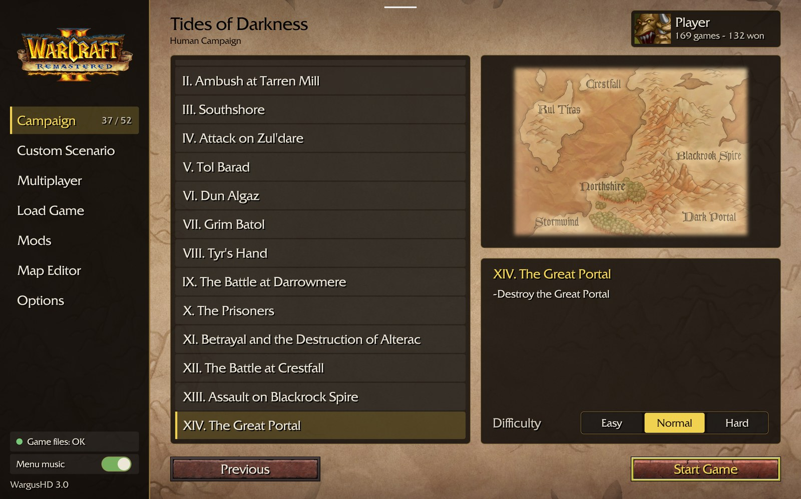
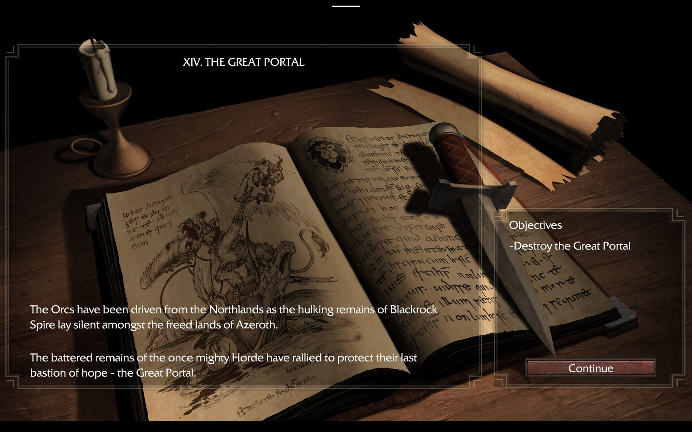
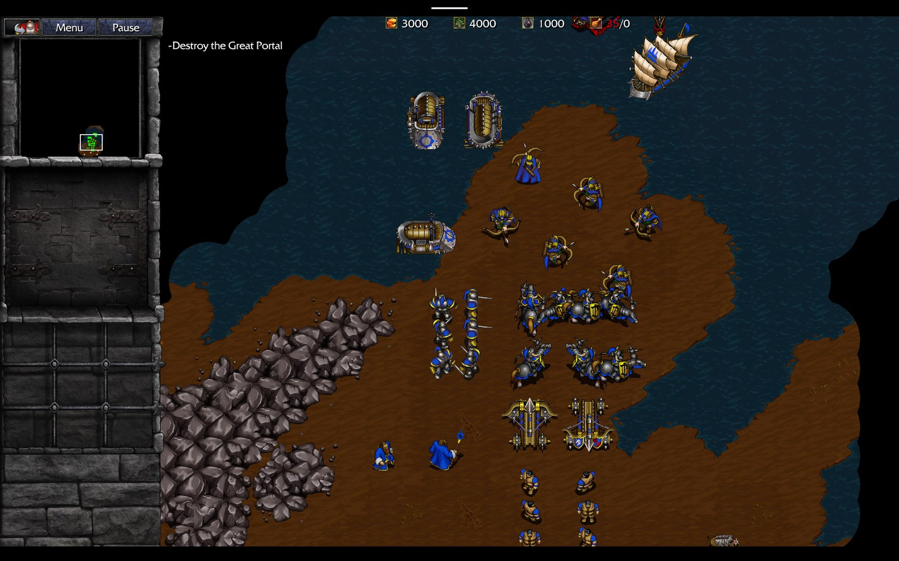
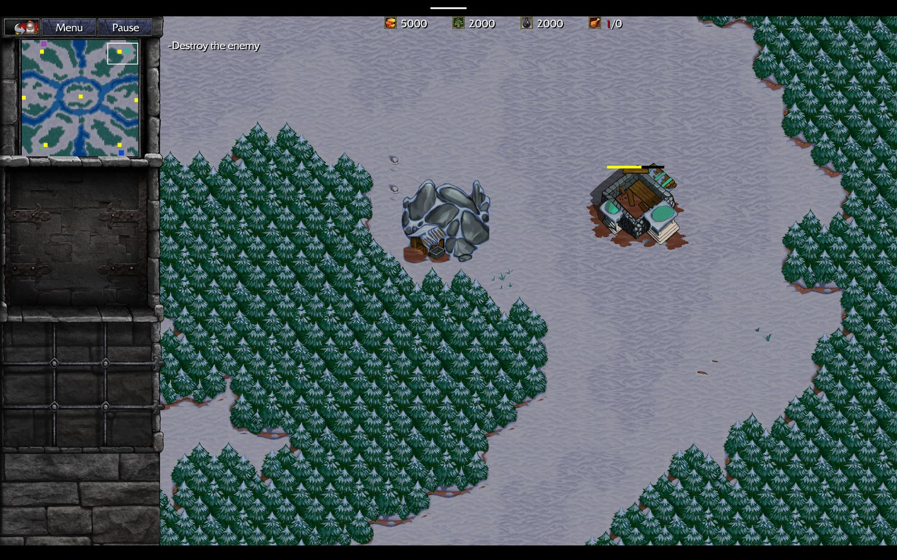
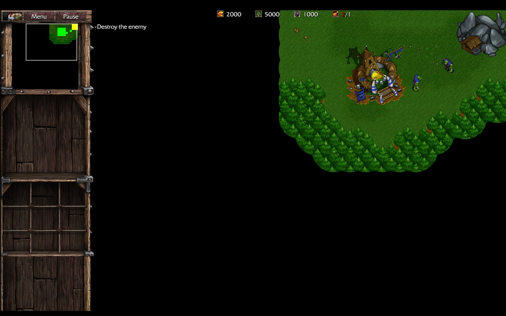
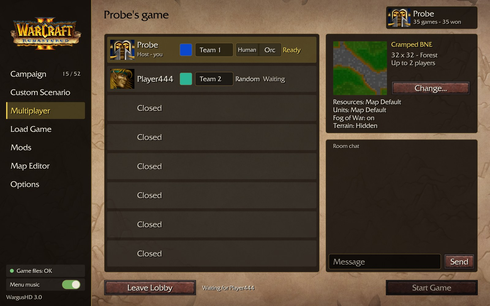
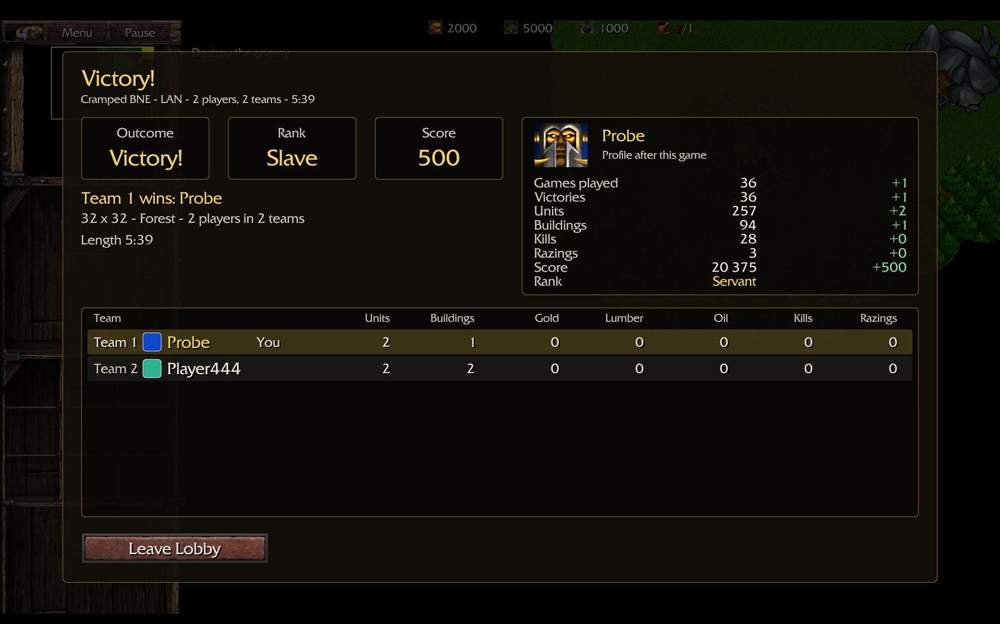
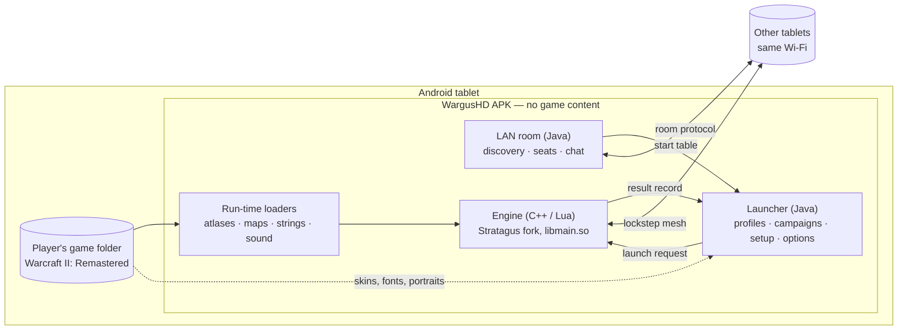

<h1 align="center">WargusHD</h1>

<p align="center">
  <b>Warcraft II: Remastered on Android tablets — an engine and a launcher that play from your own copy of the game.</b>
</p>

<p align="center">
  
  
  
  
  
  
</p>

> [!IMPORTANT]
> **This project contains no game content.** The APK holds the engine and the launcher only.
> Art, sound, music, maps, campaigns and texts are read at run time from **your own, legally owned
> copy of Warcraft II: Remastered**, whose folder you select when the app starts for the first time.
> No game data is distributed here and none may be requested here.
>
> WargusHD is not affiliated with or endorsed by Blizzard Entertainment.
> Warcraft is a trademark of Blizzard Entertainment, Inc.

## Contents

- [What it is](#what-it-is)
- [Screenshots](#screenshots)
- [Feature status](#feature-status)
- [Requirements](#requirements)
- [Installing and supplying the game files](#installing-and-supplying-the-game-files)
- [How it fits together](#how-it-fits-together)
- [Building](#building)
- [Tests](#tests)
- [Project layout](#project-layout)
- [Status and roadmap](#status-and-roadmap)
- [Credits](#credits)
- [Licence and legal notice](#licence-and-legal-notice)

## What it is

WargusHD is a port of *Warcraft II: Remastered* to Android tablets. It has two parts:

- **The engine** — a fork of [Stratagus](https://github.com/Wargus/stratagus), the free real-time
  strategy engine (C++17, SDL2, Lua). The fork adds loaders for the Remastered data formats
  (HD sprite atlases, terrain, fog masks, strings, maps, campaigns), touch input, a lockstep
  network mode for local multiplayer, and a bridge to the launcher.
- **The launcher** — a native Android front end (Java) that replaces the engine's own menus:
  game-folder check, player profiles, campaign and mission lists, custom game setup, load game,
  options, the multiplayer room and the result window. It starts the engine in a separate process
  with a launch request and reads a result record back.

The aim is to reproduce the original as closely as the files allow, not to redesign it.

## Screenshots

<table>
  <tr>
    <td width="50%"><br><sub>Launcher — Custom Game Setup with map preview</sub></td>
    <td width="50%"><br><sub>Launcher — campaign mission list and difficulty</sub></td>
  </tr>
  <tr>
    <td><br><sub>Campaign briefing</sub></td>
    <td><br><sub>Campaign mission with the Remastered HD art</sub></td>
  </tr>
  <tr>
    <td><br><sub>Custom scenario on a winter map</sub></td>
    <td><br><sub>Start of a two-tablet LAN game on a forest map</sub></td>
  </tr>
  <tr>
    <td><br><sub>LAN room — seats, teams, colours, chat</sub></td>
    <td><br><sub>Result window after a LAN game</sub></td>
  </tr>
</table>

<p align="center"><sub>Screenshots show the port running with the user's own Warcraft II: Remastered data; game art © Blizzard Entertainment.<br>
They were captured on tablets and the Android emulator during development; some show an earlier version label.</sub></p>

## Feature status

Legend: **Working** — used in the regular regression run or seen on real tablets ·
**In progress** — partly built, not finished or not fully verified · **Planned** — designed or decided, not built.

| Area | Feature | Status | Notes |
|---|---|---|---|
| Game files | Folder selection and check on first start | Working | Required files are verified; movies, speech and music are optional |
| Launcher | Home, player profiles (name, portrait, colour, statistics) | Working | |
| Launcher | Campaign pages and mission lists, progress per profile | Working | Four campaigns, 52 missions listed |
| Launcher | Custom Game Setup, map preview, map import | Working | Maps from the game folder and imported `.pud` files |
| Launcher | Load Game, Options, About / Licences | Working | |
| Launcher | Interface languages | Working | Follows the game's string tables; the launcher's own words are translated drafts |
| Game | Campaign missions: briefing, mission, victory / defeat, chain to the next | Working | Not every mission has been played through |
| Game | Custom scenarios against computer players | Working | |
| Game | Remastered HD art: terrain, units, buildings, missiles, fog of war, HUD | Working | Forest, winter, wasteland and swamp; fidelity polish continues |
| Game | Save / load, in-game Game Menu, objectives, pause | Working | |
| Game | Touch controls: tap, drag-select, control groups, placement with confirm | Working | Verified mostly through scripted input; finger checks on tablets are ongoing |
| Game | Result window with score, rank and profile statistics | Working | |
| Multiplayer | LAN room: discovery on the local network, join by address, seats, teams, colours, chat | In progress | Works on two real tablets; hidden behind a developer preview switch in current builds |
| Multiplayer | LAN game: lockstep "mesh" mode for 2–8 players, simultaneous start, waiting / return rules | In progress | Whole games played on two tablets; three or more devices not yet tested |
| Multiplayer | Pause for everyone, watching after defeat, cut-off handling | In progress | Decided; partly built, not verified |
| Multiplayer | Online play | Not planned | Local network only |
| Graphics | Classic view (the original's F5 switch) | In progress | Classic terrain and fog are drawn behind a debug call; units, HUD and the switch itself are not done |
| Performance | 60 fps cap, performance pass | Planned | |
| Tools | Map editor | Planned | Launcher entry exists; nothing behind it yet |
| Tools | Mods | Planned | Launcher entry exists; nothing behind it yet |
| Release | Signed release APK | Planned | Only debug builds have been produced and tested |

## Requirements

**To play**

- An Android tablet, Android 7.0 (API 24) or later, 64-bit ARM (`arm64-v8a`). The layout is made for
  large landscape screens; development devices are two Samsung Galaxy Tab models and the Android
  emulator. Phones are not tested.
- Your own installed copy of *Warcraft II: Remastered* (the game's folder with its `Data` directory),
  copied to the tablet's storage. About 2 GB.
- For LAN play: all devices on the same Wi-Fi network, running the same build.

**To build**

- Windows 10 / 11 with [MSYS2](https://www.msys2.org/) (UCRT64 environment) — the tested host.
- Android SDK (platform 34) and Android NDK 26.3.
- JDK 17, CMake 3.25 or later, Git.

## Installing and supplying the game files

There is no published APK yet; build one as described [below](#building), then:

1. Install it: `adb install -r android/app/build/outputs/apk/debug/app-debug.apk`.
2. Copy your *Warcraft II: Remastered* installation folder (the one that contains `Data`) from your
   PC to the tablet, for example to `Download/WC2` on internal storage or an SD card.
3. Start **WargusHD**. On first start it asks for file access and for the game folder. Select the
   folder from step 2. The app checks the required files, prepares what it needs on the device and
   opens the launcher.
4. Enter a player name and play.

The app only reads the game folder. Profiles, saves and settings are kept in the app's own storage.
The folder can be changed later under *Options ▸ Game Files*.

## How it fits together



- The launcher and the game run in **separate processes**. Every game start goes through one
  launch request (mode, map or mission, players, settings); every game end writes one result record.
- The engine draws from the game folder directly. Nothing derived from the retail files is
  packaged; where the launcher needs fonts or button faces it builds them on the device from the
  player's files.
- A LAN game is prepared in the launcher's room and then handed to the engine, which connects the
  devices to each other and runs the game in lockstep.

## Building

The Android build has three stages: a **host** build of the `tolua++` code generator, a
**cross-compile** of the engine to `libmain.so` with the NDK, and **Gradle** packaging.

| Path | State |
|---|---|
| Windows host, MSYS2 UCRT64, NDK 26.3, debug APK | Tested — this is how every development build is made |
| Linux host, native library only (`.github/workflows/android.yml`) | Workflow present; mirrors the same steps, does not package an APK |
| Linux / macOS host, full APK | Not tested |
| Release (signed, non-debuggable) APK | Not tested |

> [!NOTE]
> **What a public build contains.** The Lua scripts and data tables that drive the game on top of
> the engine are staged into the APK from a *project content manifest* that is not part of this
> repository (see the `stageWargushdContent` task in `android/app/build.gradle`). Without it the
> Gradle build still succeeds and logs `wargushdDocsRoot not set`; the resulting APK contains the
> engine and the launcher only, and has not been verified to start a game. In neither case does the
> APK contain game content.

<details>
<summary><b>1. Get the sources</b></summary>

```sh
git clone --recursive <repository-url> wargushd
cd wargushd
# if you cloned without --recursive:
git submodule update --init --recursive
```

`third-party/` is the upstream Wargus dependencies submodule (SDL2, Lua, tolua++, media libraries).
</details>

<details>
<summary><b>2. Install the tools (Windows)</b></summary>

- MSYS2, then in the *UCRT64* shell:

  ```sh
  pacman -S --needed mingw-w64-ucrt-x86_64-gcc mingw-w64-ucrt-x86_64-cmake make git
  ```

- Android SDK with platform 34 and build tools, and NDK `26.3.11579264` (Android Studio's SDK
  Manager or `sdkmanager "platforms;android-34" "ndk;26.3.11579264"`).
- JDK 17.

Set the environment in the UCRT64 shell:

```sh
export ANDROID_NDK_HOME=<path-to-ndk>
export ANDROID_HOME=<path-to-sdk>
```

and create `android/local.properties` with one line: `sdk.dir=<path-to-sdk>` (forward slashes).
</details>

<details>
<summary><b>3. Patch the dependency submodule (working tree only)</b></summary>

Four small changes are needed for the NDK build of the vendored libraries. They are applied to the
checked-out submodule and never committed. Run from the repository root in the UCRT64 shell:

```sh
# zlib: permissive version script
find third-party -name zlib.map | while read -r m; do
  printf 'ZLIB_1.2 {\n  global:\n    *;\n};\n' > "$m"; done

# libpng: static library only
find third-party -path '*/libpng/CMakeLists.txt' | while read -r f; do
  sed -i -E 's/(option\(PNG_SHARED[^)]*) ON\)/\1 OFF)/' "$f"; done

# SDL: do not promote declaration-after-statement to an error
find third-party -name CMakeLists.txt -path '*SDL*' | while read -r f; do
  sed -i 's/"-Werror=declaration-after-statement"/"-Wno-error=declaration-after-statement"/g' "$f"; done

# SDL: ALooper_pollAll is unavailable in recent NDKs
find third-party -path '*SDL*' -name '*.c' | while read -r f; do
  grep -q ALooper_pollAll "$f" && sed -i 's/ALooper_pollAll/ALooper_pollOnce/g' "$f"; done
```

The same steps, with the reason for each, are in `.github/workflows/android.yml`.
</details>

<details>
<summary><b>4. Stage A — host <code>tolua++</code></b></summary>

The engine's Lua bindings are generated at build time by `tolua++`, which must run on the host.

```sh
cmake -B build-host -G "MSYS Makefiles" -DCMAKE_BUILD_TYPE=Release \
  -DCMAKE_C_COMPILER=gcc -DCMAKE_CXX_COMPILER=g++ \
  -DBUILD_VENDORED_LUA=ON -DBUILD_VENDORED_MEDIA_LIBS=ON -DBUILD_VENDORED_SDL=ON \
  -DDOWNLOAD_FREEPATS=OFF -DBUILD_TESTING=OFF
cmake --build build-host --target lua -j 8
```

Result: `build-host/lua/src/lua-build/toluapp.exe`.
</details>

<details>
<summary><b>5. Stage B — cross-compile <code>libmain.so</code> (arm64-v8a)</b></summary>

```sh
cmake -B build-android -G "MSYS Makefiles" \
  -DCMAKE_TOOLCHAIN_FILE="$PWD/cmake/toolchains/android-arm64.cmake" \
  -DCMAKE_BUILD_TYPE=Release \
  -DBUILD_VENDORED_LUA=ON -DBUILD_VENDORED_MEDIA_LIBS=ON -DBUILD_VENDORED_SDL=ON \
  -DDOWNLOAD_FREEPATS=OFF -DBUILD_TESTING=OFF -DWITH_OPENMP=OFF \
  -DSTRATAGUS_HOST_TOLUAPP="$PWD/build-host/lua/src/lua-build/toluapp.exe"
cmake --build build-android --target stratagus -j 8
```

Result: `build-android/libmain.so`. The toolchain file pins `arm64-v8a` and `android-24` for the
engine and for every vendored sub-build. If the build fails, do not package: Gradle would pick up
an older library.
</details>

<details>
<summary><b>6. Stage C — package the APK</b></summary>

```sh
mkdir -p android/app/src/main/jniLibs/arm64-v8a
cp build-android/libmain.so android/app/src/main/jniLibs/arm64-v8a/
cd android
./gradlew assembleDebug --no-daemon
```

Result: `android/app/build/outputs/apk/debug/app-debug.apk`.

Gradle properties understood by the build:

| Property | Meaning |
|---|---|
| `-PstratagusNativeDir=<dir>` | Directory that contains `arm64-v8a/libmain.so` (default `app/src/main/jniLibs`) |
| `-PwargushdDocsRoot=<dir>` (or the same key in `local.properties`) | Root of the project content manifest; see the note above |

SDL's Android Java glue is copied from `third-party/SDL` at build time and is not kept in this tree.
</details>

<details>
<summary><b>CMake options worth knowing</b></summary>

| Option | Default | Use |
|---|---|---|
| `BUILD_VENDORED_LUA`, `BUILD_VENDORED_SDL`, `BUILD_VENDORED_MEDIA_LIBS` | `OFF` | Build Lua / tolua++, SDL2 and the media libraries from `third-party/`; all `ON` for Android |
| `STRATAGUS_HOST_TOLUAPP` | — | Path to the host `tolua++` when cross-compiling |
| `BUILD_TESTING` | — | Build the `stratagus_tests` unit tests (host only) |
| `WITH_OPENMP` | `ON` | Off for Android |
| `DOWNLOAD_FREEPATS` | `OFF` | Leave off |
| `ENABLE_TOUCHSCREEN`, `WITH_BZIP2`, `WITH_OGGVORBIS`, `WITH_THEORA`, `WITH_MNG`, `WITH_STACKTRACE`, `ENABLE_DOC`, `ENABLE_STRIP` | see `CMakeLists.txt` | Upstream Stratagus options, unchanged |
</details>

### Building the plain engine on desktop

The fork still builds as a desktop Stratagus engine, which is what the unit tests run on:

```sh
cmake -B build
cmake --build build
```

with either system SDL2 / Lua 5.1 / tolua++ development packages or the `BUILD_VENDORED_*` options.
The inherited desktop workflows (`.github/workflows/ubuntu.yml`, `windows.yml`, `macos.yml`,
`appimage.yml`) and the engine reference in `doc/` come from upstream; apart from the MSYS2 host
build used for the tests, desktop builds of this fork are not regularly checked. For desktop play
use upstream [Stratagus](https://github.com/Wargus/stratagus) and
[Wargus](https://github.com/Wargus/wargus).

## Tests

Engine unit tests ([doctest](https://github.com/doctest/doctest)) run on the host:

```sh
cmake -B build-host -G "MSYS Makefiles" -DCMAKE_BUILD_TYPE=Release \
  -DBUILD_VENDORED_LUA=ON -DBUILD_VENDORED_MEDIA_LIBS=ON -DBUILD_VENDORED_SDL=ON \
  -DDOWNLOAD_FREEPATS=OFF -DBUILD_TESTING=ON
cmake --build build-host --target stratagus_tests -j 8
./build-host/stratagus_tests
```

About 218 test cases at the time of writing: network messages, the LAN mesh, path finding,
triggers, HD atlas loading, UI scaling and anchoring, content rules.

On-device behaviour (scenario start, pause, game menu, save / load round trip, victory and result
window, campaign briefing) is checked by a scripted regression run against a debug build; that
harness is not part of this repository.

## Project layout

```
android/                Android project (Gradle)
  app/src/main/java/net/wargushd/game/        launcher, game activity, on-device art and font bakers
  app/src/main/java/net/wargushd/game/lan/    LAN room: identity, sockets, wire format
cmake/toolchains/       android-arm64.cmake and other toolchain files
src/                    engine (Stratagus fork)
  network/              lockstep networking, LAN mesh
  video/ map/ unit/ ui/ rendering, HD atlases, terrain, fog, HUD
  stratagus/ game/      main loop, Remastered missions and strings, save / load
  debug/                debug bridge (debuggable builds only)
  tolua/                Lua binding definitions
tests/                  host unit tests
tools/                  build-time tools (version generator, HD atlas importer, shaders)
third-party/            dependencies submodule (SDL2, Lua, tolua++, media libraries, doctest)
doc/                    upstream engine and scripting reference
docs/screenshots/       images used in this file
.github/workflows/      android.yml (native arm64 library) and inherited desktop workflows
```

## Status and roadmap

Version **3.4.0**. Single-player — campaigns and custom scenarios with the Remastered art, profiles,
save / load — is playable on tablets and covered by the regression run. Work in hand, in order:

1. **LAN multiplayer hardening** — the remaining two-tablet checks (cut-off handling, pause for
   everyone, background / screen-off, repeated starts), then three and more devices, then removal
   of the preview switch.
2. **Classic view** — the original's switch between Remastered and classic graphics: units, HUD,
   picture scaling and the switch itself.
3. **In-game polish** — remaining differences from the original in HUD, effects and unit behaviour.
4. **Performance** — frame pacing and loading times.
5. **Map editor** and **mods**.
6. **Release build** — a signed, non-debuggable APK.

Known limits today: debug builds only; `arm64-v8a` only; LAN needs a developer switch; classic view
is not selectable by the player; no phone layout.

## Credits

- **[Stratagus](https://github.com/Wargus/stratagus)** — the engine this repository is forked from,
  by The Stratagus Project and its contributors.
- **[Wargus](https://github.com/Wargus/wargus)** — the Warcraft II game scripts for Stratagus, on
  which the port's game logic builds, and the
  [dependencies](https://github.com/Wargus/dependencies) collection used for the vendored build.
- **SDL2**, **Lua**, **tolua++**, **Guichan**, **doctest** and the other third-party components,
  each under its own licence (see `doc/` and `third-party/`).

Maintained by **WargusHD**.

## Licence and legal notice

The engine and the launcher are free software under the **GNU General Public License, version 2**;
see [`COPYING`](COPYING). Third-party components keep their own licences.

*Warcraft II: Remastered*, its art, sound, music, maps, campaigns and texts are the property of
Blizzard Entertainment, Inc. They are **not** part of this repository or of any package built from
it, and are not covered by the licence above. To use WargusHD you must own the game and supply its
files yourself. Do not ask for, post or link game data in this project's issues or discussions.

WargusHD is an independent, non-commercial project. It is not affiliated with, endorsed by or
sponsored by Blizzard Entertainment. Warcraft and Blizzard Entertainment are trademarks or
registered trademarks of Blizzard Entertainment, Inc.
